  
  
  

## ⚡ CYBERWARE LOADOUT

| Slot | Implant | Stats |
| :--- | :--- | :--- |
| 🔫 **Weapon** | **Java 17+ & Spring Boot** | `STR +99` · Enterprise server-side, RESTful APIs, fintech systems |
| 🧥 **Armor** | **Angular (v2 → 20) + TypeScript + SCSS** | `DEX +92` · SPA builds and legacy-to-modern migrations |
| 🛡️ **ICE** | **MFA (OTP / TOTP)** | `LUK +90` · Financial security standards & AU compliance |
| 👁️ **Optics** | **AWS Textract OCR** | `INT +99` · Document automation pipelines |
| 🧠 **Neural Chip** | **Claude Code Workflows & CI/CD** | `INT +10` · AI-assisted dev & automation |
| 🤖 **Drone** | [**Guaiwu**](https://github.com/HsiaoJ0629) | Offline digital pet desktop app: Tauri, Angular 20, PixiJS, SQLite, Ollama, ComfyUI |

## 💾 SKILL TREE

<table>
<tr><th>Program</th><th>Lv.</th><th>Effect</th></tr>
<tr><td>⚔️ <b>Backend Architecture</b></td><td><code>MAXED</code></td><td>Designs and maintains high-volume Java / Spring Boot services</td></tr>
<tr><td>✨ <b>Frontend Craft</b></td><td><code>29/30</code></td><td>Builds and migrates Angular SPAs across every major version</td></tr>
<tr><td>🔍 <b>Root-Cause Analysis</b></td><td><code>MAXED</code></td><td>Owns production incidents end to end. Bugs take 300% damage</td></tr>
<tr><td>🤖 <b>Automation &amp; AI</b></td><td><code>MAXED</code></td><td>Deploys OCR and Claude Code daemons to do the grinding</td></tr>
<tr><td>🛡️ <b>Security &amp; Compliance</b></td><td><code>29/30</code></td><td>Uploads MFA firewall to all crew members</td></tr>
<tr><td>📚 <b>Developer Experience</b></td><td><code>MAXED</code></td><td>Crew buff: onboarding docs and coding standards for the whole team</td></tr>
</table>

## 📡 GIG LOG

> **Completed** `4 / 4`

| Gig | Payout |
| :--- | :--- |
| ✅ **Fintech Scaler**: Architect and maintain loan origination systems | 🏆 1,000+ applications processed monthly |
| ✅ **Security Sentinel**: Roll out OTP / TOTP MFA across financial systems | 🛡️ Australian compliance achieved |
| ✅ **Automation Alchemist**: Build AWS Textract OCR workflows | 💰 −70% manual data entry · 20+ hrs saved / month |
| ✅ **DevExp Enhancer**: Create a Claude Code onboarding knowledge base | ⚡ New dev ramp-up 50% faster |

> **In progress** `1`

| Gig | Status |
| :--- | :--- |
| 🔄 **Raise a Guaiwu**: Ship an offline AI pet to the desktop | `██████░░░░` Side gig active |

## 📟 COMMLINK

*Crew invites welcome. Open a secure channel to connect.* 🌃

